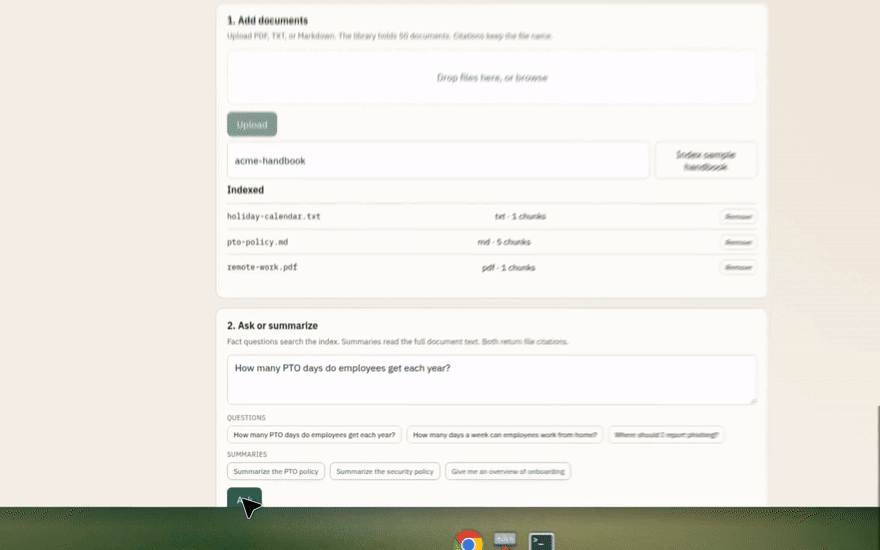
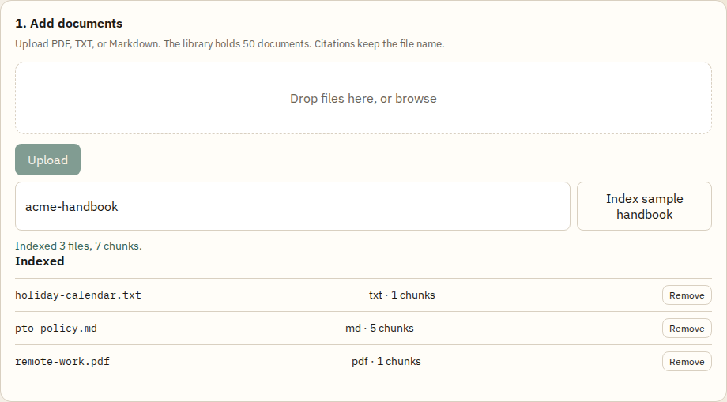
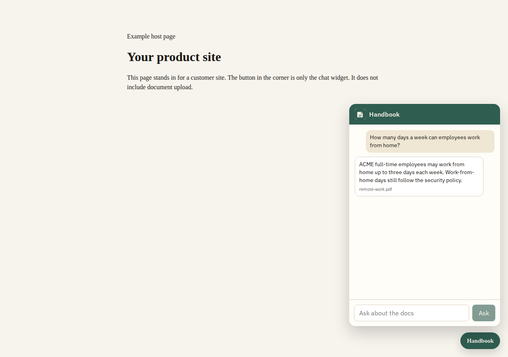

# Acme Docs Copilot

[](docs/screenshots/demo.gif)

React console for the [Acme Docs Copilot API](https://github.com/hassan2314/co-pilot). Upload PDF, TXT, or Markdown, ask a question, and read the answer with the file it came from. A second page is a chat-only widget you can drop onto another site.

```text
co-pilot/       FastAPI + ADK + pgvector
co-pilot-ui/    this app
```





## Run it locally

The API should already be listening on `http://127.0.0.1:8001`. Setup for that repo is in its README (Postgres with pgvector, then `uvicorn app.main:app --port 8001`).

```bash
cp .env.example .env
npm install
npm run dev
```

Open http://127.0.0.1:5173.

`.env` is only for local development:

```env
VITE_API_URL=http://127.0.0.1:8001
```

Production builds ignore `VITE_API_URL` and call `/api` on the same origin. See the Netlify section.

## Using the console

1. Drop PDF, TXT, or Markdown files and choose **Upload**. The API keeps up to 50 documents. Uploading the same file name replaces that document.
2. **Index sample handbook** sends `POST /v1/ingest` for the markdown folder shipped with the API (`acme-handbook`).
3. Ask a fact, or ask for a summary. The answer lists the file names it used.
4. Copy the embed snippet. **Open the host-page demo** loads `/widget-demo.html`, which is only the chat button.

The screenshots use the fictional ACME handbook (`pto-policy.md`, `remote-work.pdf`, `holiday-calendar.txt`).

## Embed the chat

Paste this on any page. The button opens a panel that only asks questions. It does not show upload, delete, or the document list.

```html
<script
  src="https://acme-copilot.netlify.app/widget.js"
  data-name="Handbook"
  data-color="#2f5d50"
  data-logo="https://example.com/logo.png"
  defer
></script>
```

| Attribute | Meaning |
|-----------|---------|
| `data-name` | Header and button label |
| `data-color` | `#rgb` or `#rrggbb` |
| `data-logo` | `http(s)` image, or a path on this UI such as `/mark.svg` |
| `data-origin` | UI origin, if the script tag is not served by this app |

The script creates an iframe to `/embed` on this app. The iframe talks to `/api`, which Netlify forwards to the API, so the host page does not need its own CORS setup.

There is a second snippet, served by the API at `/widget.js`, that calls the API directly from the host page. That one needs `CORS_ALLOW_ALL=true` (or the host origin) on the API. The API README has that snippet.

## Netlify

`netlify.toml` is the deploy config:

- Build command: `npm run build`
- Publish directory: `dist`
- `/api/*` is proxied to `https://co-pilot.fastapicloud.dev/*` (status 200)
- Every other path falls through to `index.html`, so `/embed` and client routes work

The site that matches this repo is **https://acme-copilot.netlify.app**. A request to `/api/health` today waits until it times out, because the API host accepts TLS and then returns no body. Details and the steps that need the FastAPI Cloud account are in the API README. Republishing this UI will not fix that until the API is redeployed with a reachable database.

Netlify rebuilds when the linked branch updates. This repository has no GitHub Actions workflow. `VITE_API_URL` does not affect the production bundle.

## Scripts

```bash
npm run dev       # http://127.0.0.1:5173
npm run build     # dist/
npm run preview
```
